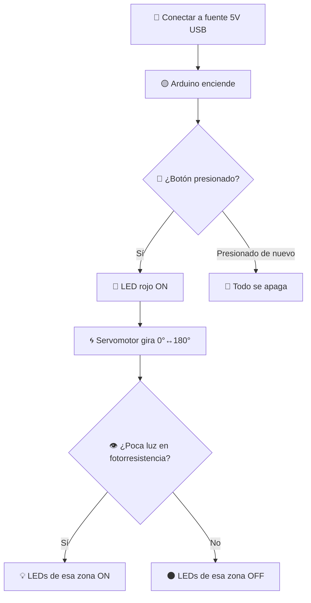

<div align="center">

# 🏡⚡ Arduino's House

### Casa inteligente y sustentable con generador eólico simulado


</div>

---

## Demo

<div align="center">

[](https://youtu.be/T3kQDBAK7Cg)

</div>

---

## Descripción

**Arduino's House** es una maqueta funcional que simula una casa con jardín automatizado y un generador eólico, diseñada para **reducir el consumo de energía eléctrica** mediante sensores de luz ambiental.

> 💡 Al presionar un botón, el sistema se activa: el generador eólico comienza a girar y las luces del jardín se encienden o apagan automáticamente según la cantidad de luz ambiental detectada por 3 fotorresistencias.

Proyecto final de la materia **Introducción a la Computación (T02D)** — Universidad Politécnica de San Luis Potosí.

---

## Objetivo

> Reducir el consumo de energía de las luces y de un generador eólico en el interior y jardín de una casa, promoviendo el uso de energías renovables.

---

## Características

| 🔧 Componente | 📋 Cantidad | 🎨 Función |
|---|---|---|
| 🔴 LED rojo | 1 | Indica que el sistema está activado |
| 🔵 LED azul | 4 | Iluminación jardín (zona izquierda/derecha) |
| ⚪ LED blanco | 4 | Iluminación jardín (zona central) |
| 🌀 Servomotor | 1 | Simula generador eólico (giros 0°–180°) |
| 👁️ Fotorresistencias | 3 | Detectan luz ambiental por zona |
| 🔘 Botón | 1 | Enciende/apaga el sistema completo |

### Zonas del jardín

```
 Izquierda  |  Central  |  Derecha
   💡💡     |  💡💡💡💡  |   💡💡
 2 LEDs azul| 4 LEDs blanco | 2 LEDs azul
```

- Poca luz ambiental → 💡 LEDs de la zona se **encienden**
- Mucha luz ambiental → 🌑 LEDs de la zona se **apagan**

---

## ¿Cómo funciona?



---

## Hardware utilizado

- Arduino (compatible UNO)
- 1 Servomotor
- 8 LEDs (4 azules + 4 blancos + 1 rojo indicador)
- 3 Fotorresistencias (LDR)
- 1 Botón pulsador
- Resistencias, cables y protoboard
- Maqueta de cartón/madera con pasto artificial 🌿

---

## Código

El código completo (`.ino`) está en [`src/`](./src). Estructura general:

```cpp
#include <Servo.h>          // Librería para el servomotor
Servo servoMotor;
int CUENTA = 0;

void setup() {
  servoMotor.attach(3);     // Servo en pin digital 3
  pinMode(13, INPUT);       // Botón
  pinMode(12, OUTPUT);      // LED indicador
  pinMode(A1, INPUT);       // Fotorresistencia izquierda
  pinMode(A2, INPUT);       // Fotorresistencia central
  pinMode(A3, INPUT);       // Fotorresistencia derecha
  // ... resto de pines de LEDs
}

void loop() {
  // Lee el botón para activar/desactivar el sistema
  // Si está activo: lee las 3 fotorresistencias
  // y enciende/apaga los LEDs de cada zona
  // mientras el servomotor alterna giros de 0° a 180°
}
```

📎 Ver código completo comentado: [`src/ArduinoHouse.ino`](./src/ArduinoHouse.ino)

---

## Manuales

| Documento | Contenido |
|---|---|
| 📄 [Manual del Proyecto](docs/Manual_Proyecto.pdf) | Cómo conectar, activar y apagar el sistema paso a paso, pseudocódigo, explicación técnica del código |


---

## Cómo usarlo

1. 🔌 Conecta el Arduino a una fuente de 5V vía USB
2. 🟡 El LED "ON" del Arduino se encenderá automáticamente
3. 🔘 Presiona el botón durante 1 segundo → se activa el sistema
4. 🔴 El LED rojo se enciende y el generador eólico comienza a girar
5. 💡 Los LEDs del jardín reaccionan automáticamente a la luz ambiental
6. 🔘 Presiona el botón de nuevo → todo se apaga

---

## Autores

Proyecto desarrollado en equipo para **Introducción a la Computación T02D**, UPSLP — 29 de noviembre de 2024.

- **David Alejandro Tristán Contreras**
- **María Guadalupe Zamora Martínez**

Docente: *Imelda Deyanira Hernández Martínez*

---

## Justificación

> Este proyecto busca reducir la contaminación generada por el consumo excesivo de energía eléctrica, promoviendo el uso de energía eólica renovable, con beneficios tanto ambientales como económicos para los hogares que la implementen.

---

<div align="center">

</div>
